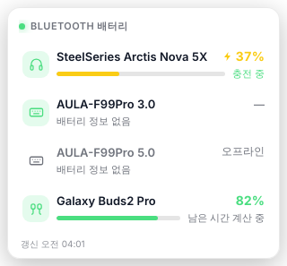

# BT Battery Overlay

Windows용 **블루투스 장치 배터리 오버레이**입니다. 트레이에 상주하면서 반투명 패널로
연결된 블루투스 장치의 배터리 잔량과 **남은 예상 시간**을 항상 위에 띄워 줍니다.



## 기능

- 페어링된 블루투스 장치 자동 검색, 원하는 장치만 골라서 표시
- 배터리 % + 게이지, 잔량에 따른 색상(녹색/노랑/주황/빨강)
- **남은 예상 시간**: 배터리 소모 이력을 기록해 선형 회귀로 추정 (충전 중 / 계산 중 상태 표시)
- 반투명 글래스 UI, **배경 투명도 / 전체 투명도** 슬라이더, 다크·라이트 테마, 강조색, 컴팩트 모드
- 항상 위에 표시, 드래그 이동, 위치 잠금, 클릭 통과(마우스 무시)
- 배터리 부족 알림(임계값 설정), Windows 시작 시 자동 실행
- 트레이 아이콘: 툴팁에 배터리 요약, 우클릭 메뉴로 빠른 조작

## 사용법

1. `BT-Battery-Overlay-<버전>-portable.exe` 를 실행합니다. (설치 불필요)
2. 우측 상단에 오버레이가 뜹니다. 패널에 마우스를 올리면 ⟳(새로고침) ⚙(설정) −(숨기기) 버튼이 나타납니다.
3. 설정 창에서 표시할 장치를 체크하고 투명도 등을 조절합니다. 아무 장치도 선택하지 않으면
   배터리를 보고하는 연결된 장치가 모두 표시됩니다.
4. 트레이 아이콘 클릭 = 오버레이 표시/숨기기, 더블클릭 = 설정, 우클릭 = 메뉴.

설정은 `%APPDATA%\bt-battery-overlay\settings.json`, 배터리 이력은 같은 폴더의 `history.json`에 저장됩니다.

## 배터리가 표시되지 않는 장치

이 앱은 **Windows가 알고 있는 배터리 값**(설정 > Bluetooth 및 장치 에서 보이는 %)을 읽습니다.
Windows 블루투스 설정에 %가 안 보이는 장치는 현재 연결 모드에서 배터리를 Windows에 보고하지 않는 것이라
앱에서도 표시할 수 없습니다. 이런 장치는 설정의 "배터리 정보 없는 장치도 표시"를 켜면 연결 상태만 표시됩니다.

- 3.0/5.0 처럼 **두 가지 블루투스 모드를 가진 키보드·마우스**는 보통 LE(5.0) 모드에서만 배터리(GATT Battery Service)를
  보고합니다. 클래식(3.0) 모드로 연결돼 있으면 Windows에도 %가 없으므로, 5.0 모드로 연결하면 표시됩니다.
- 배터리가 보여야 할 장치가 안 보이면 설정 창의 **진단 정보 복사** 버튼으로 장치 트리 원본(JSON)을 복사해 공유해 주세요.

## 동작 원리

`powershell.exe`(숨김)로 PnP 장치 트리에서 블루투스 관련 노드(`BTH*`, 블루투스 HID 하위 노드, Battery 클래스)를
한 번에 열거하고 다음 장치 속성을 읽습니다. 최상위 장치(`BTHENUM\DEV_*` / `BTHLE\DEV_*`)가 설정 화면에 보이는 장치이며,
배터리 값이 하위 서비스 노드(예: 핸즈프리)에 붙어 있는 경우 부모 체인/주소로 최상위 장치에 귀속시킵니다.

| 속성 | 키 |
|---|---|
| 배터리 | `DEVPKEY_Bluetooth_Battery` `{104EA319-6EE2-4701-BD47-8DDBF425BBE5} 2` |
| 연결 여부 | `DEVPKEY_Device_IsConnected` `{83DA6326-97A6-4088-9453-A1923F573B29} 15` |
| 주소 | `DEVPKEY_Bluetooth_DeviceAddress` `{2BD67D8B-8BEB-48D5-87E0-6CDA3428040A} 1` |
| 부모 노드 | `DEVPKEY_Device_Parent` `{A45C254E-DF1C-4EFD-8020-67D146A850E0} 8` |

## 개발 / 빌드

```bash
npm install
npm test            # 추정 로직 / 파서 단위 테스트
npm start           # 개발 실행 (Windows 외 OS에서는 가짜 장치 데이터로 동작)
npm run icons       # assets/ 아이콘 재생성
npm run dist        # dist/BT-Battery-Overlay-<버전>-portable.exe 생성
```

Windows 이외의 OS에서 빌드할 때는 exe 아이콘/버전 정보 편집(wine 필요)을 건너뛰도록
`build.win.signAndEditExecutable` 이 `false` 로 설정되어 있습니다. Windows에서 빌드하거나 wine을 설치한 경우
`true` 로 바꾸면 `assets/icon.ico` 가 exe 아이콘으로 들어갑니다.
